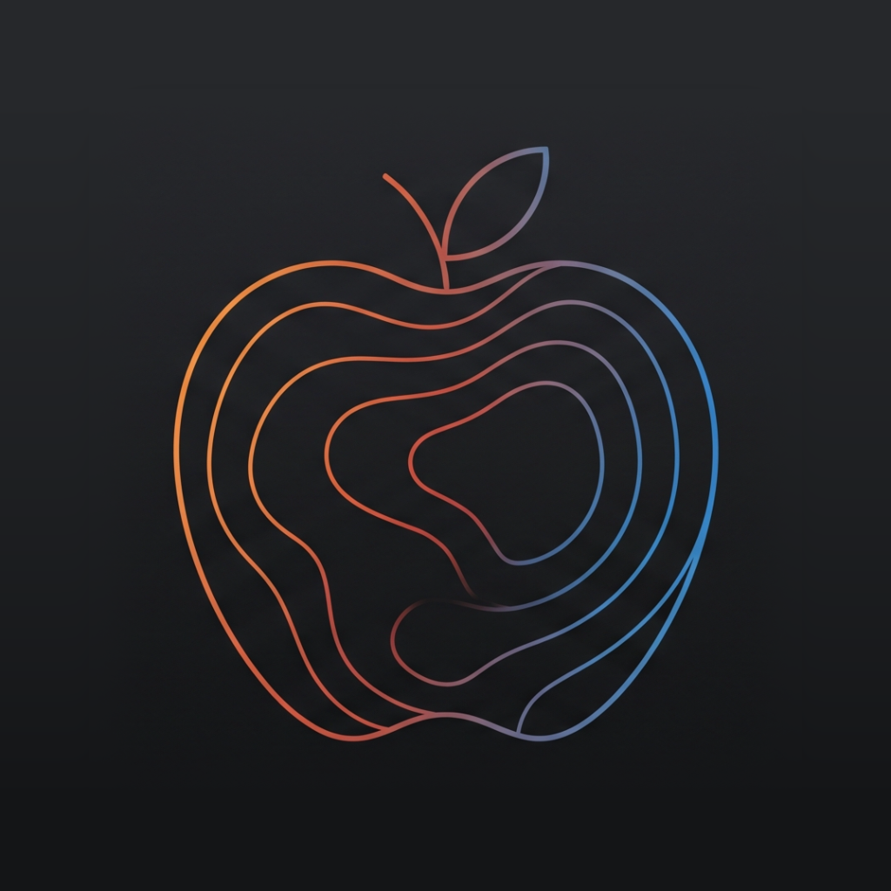

<p align="center">
  
</p>

<h1 align="center">MacroDepth</h1>

<p align="center">
  <strong>Point your iPhone at your plate. Get your macros.</strong><br>
  An AI food tracker that measures portions with LiDAR instead of guessing them.
</p>

<p align="center">
  
  
  
</p>

---

Most photo-based calorie trackers ask an AI to guess how much food is on the plate, and portion size is exactly where those guesses go wrong. MacroDepth splits the job in two:

- **Gemini** looks at the photo and identifies each food, its category and its likely density.
- **The iPhone's LiDAR sensor** measures how much of each food there actually is, with on-device geometry turning depth into volume and volume into grams.

Grams are always computed on the device. The AI says *what* is on the plate; the depth sensor says *how much*. Everything you log is stored locally with SwiftData.

## Features

- 📸 **Depth-measured scanning.** Photograph your plate and every item is detected, measured and broken down into protein, carbs, fat, fibre and calories. On iPhones without LiDAR, scanning still works using photo estimates.
- 🔎 **Hybrid food search.** A built-in catalog of whole foods (in English and Swedish) answers instantly and offline, and [Open Food Facts](https://world.openfoodfacts.org) adds millions of branded products.
- 🏷️ **Barcode scanning** for packaged foods.
- ✍️ **Classic tracking fallback.** No LiDAR, bad lighting, or just a snack? Search, scan a barcode or enter food by hand.
- ⭐ **Quick re-log.** Favorite and recent foods remember your usual portion, and you can copy yesterday's meals to today in one tap.
- 📖 **Recipe book.** Save any meal as a template and log it again later.
- ❤️ **Apple Health sync** (opt-in). Meals are written to Health as nutrition, edits and deletions follow automatically, and body weight comes in from Health to your progress charts.
- 🎯 **Personal targets.** Daily calorie and macro goals calculated from your profile and goal, or set by hand.
- 📈 **Progress tracking** with weight trends and daily totals.
- 🧹 **Automatic photo pruning.** Meal photos are deleted after 7 days to save space, while your logged meals and macros are kept for good.
- 🔐 **Bring your own key.** No API key ships with the app. Yours stays in the iPhone's Keychain.

## Requirements

- An iPhone running **iOS 17 or later**. A LiDAR-equipped Pro model gives measured portions; other iPhones use photo estimates.
- A Mac with **Xcode 16 or later** and [XcodeGen](https://github.com/yonaskolb/XcodeGen).
- An **Apple ID** for signing. A free account works for running on your own phone.
- A **Gemini API key**, free from [Google AI Studio](https://aistudio.google.com/apikey).

## Getting started

### 1. Clone and generate the project

```sh
git clone https://github.com/Fille2345/MacroDepth.git
cd MacroDepth/MacroDepth
brew install xcodegen      # if you don't have it yet
```

### 2. Set your signing team

The Xcode project is generated from `project.yml`, so signing settings made in Xcode are lost on the next regeneration. Put them in a local config file instead. It's git-ignored, so it never gets committed.

```sh
cp Config/Local.example.xcconfig Config/Local.xcconfig
```

Open `Config/Local.xcconfig` and uncomment and fill in two lines:

```
MACRODEPTH_BUNDLE_IDENTIFIER = se.yourname.MacroDepth
DEVELOPMENT_TEAM = ABCDE12345
```

- **Bundle identifier:** any reverse-domain name that's unique to you.
- **Team ID:** find it in Xcode under *Settings → Accounts → (your Apple ID) → Team*, or at [developer.apple.com/account](https://developer.apple.com/account) under *Membership details*. Apple Health requires a team to sign the app.

### 3. Build to your iPhone

```sh
xcodegen generate
open MacroDepth.xcodeproj
```

In Xcode, select the **MacroDepth** scheme and your iPhone as the destination, then press **Run** (⌘R). The first time, your iPhone may ask you to trust the developer under *Settings → General → VPN & Device Management*.

### 4. Add your Gemini API key in the app

There is no key in the code, and nothing to paste into a config file.

1. Create a free key at [Google AI Studio](https://aistudio.google.com/apikey).
2. In MacroDepth, open **Settings → Gemini** and paste it in. If you start a scan without a key, the app asks for one.

The key is stored in the iPhone's Keychain, never leaves the device except in requests to Google, and can be replaced or removed from Settings at any time.

### Optional: turn on Apple Health

Go to **Settings → Apple Health** and allow access. MacroDepth writes your meals' nutrition and reads your body weight.

## Running the tests

```sh
xcodebuild test -scheme MacroDepth \
  -destination 'platform=iOS Simulator,name=<your simulator>'
```

The test suite uses Swift Testing and runs entirely offline. In the Simulator, scanning uses a built-in sample scene, so you can try the full flow without a device.

## Privacy

- Meals, weights, targets and photos are stored **only on your device**.
- When you scan, the photos, the measured volumes and any notes you add are sent to Google's Gemini API **using your own key**. The raw depth map and your meal history are never uploaded.
- Food searches go to Open Food Facts. Apple Health data is only read or written when you turn sync on.
- There are no analytics, accounts or servers of our own.

## Project structure

```
MacroDepth/
├── project.yml          XcodeGen spec
├── Config/              Build settings (Local.xcconfig is yours, git-ignored)
├── MacroDepth/
│   ├── App/             Entry point and dependency container
│   ├── Domain/          Models, SwiftData schema, portion math
│   ├── Services/        Gemini, ARKit scanner, Health, food lookup, persistence
│   ├── Features/        SwiftUI screens and their view models
│   └── Support/         Formatters, configuration, sample data
└── MacroDepthTests/     Swift Testing suites
```

For design decisions and the conventions the code follows, see [`ARCHITECTURE.md`](MacroDepth/ARCHITECTURE.md).

## Disclaimer

MacroDepth gives **estimates**. Depth measurement, AI food recognition and nutrition databases all have error margins. It is not a medical device and isn't meant for clinical or medical dietary decisions.

## Acknowledgements

- Product data from [Open Food Facts](https://world.openfoodfacts.org), available under the [Open Database License](https://opendatacommons.org/licenses/odbl/1-0/).
- Whole-food nutrition values from [USDA FoodData Central](https://fdc.nal.usda.gov).
- Food recognition by Google [Gemini](https://ai.google.dev).

## License

MacroDepth is released under the [MIT License](LICENSE). © 2026 Filip Biörklund
